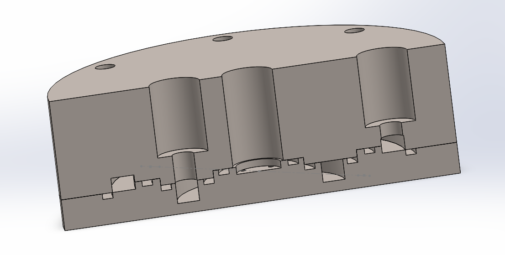
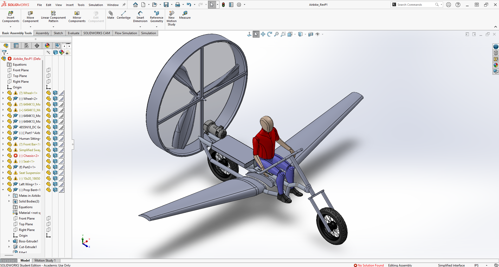
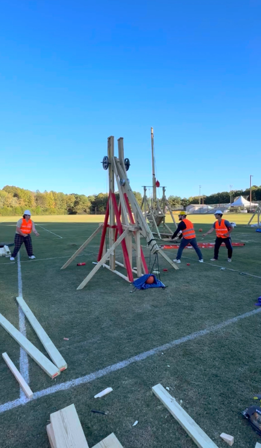

<header class="bp-header">
  

  

  

  Aerospace &amp; Mechanical Engineering
  Dual Degree • Math Minor
  

  <h1 class="bp-name">Lucas Lebron</h1>
  

  

  <a class="bp-action-link" href="https://www.linkedin.com/in/lucaslebron/" target="_blank" rel="noopener noreferrer">
  <svg class="bp-action-icon" fill="none" stroke="currentColor" stroke-width="2" viewBox="0 0 24 24" aria-hidden="true"><path stroke-linecap="square" d="M16 8a6 6 0 016 6v7h-4v-7a2 2 0 00-4 0v7h-4v-7a6 6 0 016-6zM2 9h4v12H2z"/><circle cx="4" cy="4" r="2"/></svg>
  LinkedIn
  </a>
  <a class="bp-action-link" href="https://github.com/Lucaslbron" target="_blank" rel="noopener noreferrer">
  <svg class="bp-action-icon" fill="none" stroke="currentColor" stroke-width="2" viewBox="0 0 24 24" aria-hidden="true"><path stroke-linecap="square" d="M9 19c-5 1.5-5-2.5-7-3m14 6v-3.87a3.37 3.37 0 00-.94-2.61c3.14-.35 6.44-1.54 6.44-7A5.44 5.44 0 0020 4.77 5.07 5.07 0 0019.91 1S18.73.65 16 2.48a13.38 13.38 0 00-7 0C6.27.65 5.09 1 5.09 1A5.07 5.07 0 005 4.77a5.44 5.44 0 00-1.5 3.78c0 5.42 3.3 6.61 6.44 7A3.37 3.37 0 009 18.13V22"/></svg>
  GitHub
  </a>
  <a class="bp-action-link" href="mailto:lucaslbron@proton.me">
  <svg class="bp-action-icon" fill="none" stroke="currentColor" stroke-width="2" viewBox="0 0 24 24" aria-hidden="true"><path stroke-linecap="square" d="M3 8l9 6 9-6M4 6h16v12H4z"/></svg>
  Email Me
  </a>
  <a class="bp-action-link bp-action-link--accent" href="assets/docs/resume-lucas-lebron.pdf">
  <svg class="bp-action-icon" fill="none" stroke="currentColor" stroke-width="2" viewBox="0 0 24 24" aria-hidden="true"><path stroke-linecap="square" d="M12 3v12m0 0l-4-4m4 4l4-4M4 17v2h16v-2"/></svg>
  Resume (PDF)
  </a>
  <a class="bp-action-link" href="class-schedule.html">
  <svg class="bp-action-icon" fill="none" stroke="currentColor" stroke-width="2" viewBox="0 0 24 24" aria-hidden="true"><rect x="3" y="4" width="18" height="18"/><path stroke-linecap="square" d="M16 2v4M8 2v4M3 10h18"/></svg>
  Class Schedule
  </a>
  

  

  

  <h2 class="bp-about-title">// About Me</h2>
  
I am an undergraduate senior pursuing a dual degree in Aerospace Engineering and Mechanical Engineering, with a minor in Mathematics. I have always been drawn to engineering problems where theory, computation, and physical hardware are pushed to the limit of human knowledge, which ultimately led me toward aerospace engineering.

  
My current interests are focused around various aerospace fields such as structures, aerodynamics, propulsion, and materials. Through coursework and personal projects, I have developed experience with CAD, structural and thermal analysis, CFD, and engineering simulation, while also gaining experience turning those analyses into improved practical designs.

  
I built this portfolio to document that progression; Not only the projects I have completed, but also the problems I am currently solving, and the ones I am interested in tackling next.

  

</header>

<nav class="bp-tab-nav" role="tablist" aria-label="Engineering Portfolio Sections">
  <button type="button" class="bp-tab-btn is-active" id="tab-completed" role="tab" aria-selected="true" aria-controls="panel-completed" data-tab="completed" tabindex="0">
  Completed Projects
  03
  </button>
  <button type="button" class="bp-tab-btn" id="tab-in-progress" role="tab" aria-selected="false" aria-controls="panel-in-progress" data-tab="in-progress" tabindex="-1">
  In Progress
  04
  </button>
  <button type="button" class="bp-tab-btn" id="tab-planned" role="tab" aria-selected="false" aria-controls="panel-planned" data-tab="planned" tabindex="-1">
  Planned Projects
  02
  </button>
  <button type="button" class="bp-tab-btn" id="tab-research" role="tab" aria-selected="false" aria-controls="panel-research" data-tab="research" tabindex="-1">
  Research Experience
  03
  </button>
</nav>

<section id="panel-completed" class="bp-tab-panel is-active" role="tabpanel" aria-labelledby="tab-completed" aria-hidden="false" style="display: block;">
  

  <h2 class="bp-panel-title">// Section 01: Completed Engineering Projects</h2>
  3 ARCHIVED ENTRIES
  

  

  <article class="bp-card">
  

  

  

  

  Completed
  Propulsion • Fluids • 3D CAD Modeling
  

  <h3 class="bp-card-title">1. Impinging Injector for Liquid Rocket Booster</h3>
  
Overview

  
Designed and evaluated a bi-propellant Impinging injector assembly, with emphasis on atomization efficiency, spray cone angle, and pressure drop.

  
Methods

  
Developed the injector geometry and evaluated its fluid-flow and atomization characteristics through engineering analysis and simulation.

  

  

  
Tools

  

  SolidWorks
  ANSYS
  

  

  

  <aside class="bp-card-right">
  

  
  
FIG 01 // Injector CAD Assembly

  

  

  
Focus

  

  Propulsion
  Fluids
  3D CAD Modeling
  

  

  

  <a class="bp-action-link bp-action-link--accent bp-action-link--card" href="projects/injector-quick-overview.html">Read Quick Overview→</a>
  <a class="bp-action-link bp-action-link--card" href="projects/injector/">Read Full Project Report→</a>
  <a class="bp-action-link bp-action-link--card" href="projects/injector-cad-viewer.html">Interactive 3D CAD Viewer⛶</a>
  

  </aside>
  

  </article>

  <article class="bp-card">
  

  

  

  

  Completed
  Structural Analysis • CFD • Thermal Analysis
  

  <h3 class="bp-card-title">2. Electric Airbike Structural, Aerodynamic, &amp; Thermal Simulations</h3>
  
Overview

  
A Comprehensive, simulation-driven design of an electric airbike, using SolidWorks to transition from initial CAD geometries to optimized, data-backed engineering solutions.

  
Methods

  
Performed structural FEA, CFD, and thermal simulations to evaluate and refine major vehicle components, including the chassis, seat, airfoils, propeller, heat exchanger, and battery system.

  

  

  
Tools

  

  SolidWorks
  SolidWorks Flow Simulation
  FEA Stress Analysis
  Thermal Analysis
  

  

  

  <aside class="bp-card-right">
  

  
  
FIG 02 // Full Vehicle CAD Assembly

  

  

  
Focus

  

  Structural Analysis
  Computational Fluid Dynamics
  Thermal Analysis
  

  

  

  <a class="bp-action-link bp-action-link--accent bp-action-link--card" href="projects/airbike-quick-overview.html">Read Quick Overview→</a>
  <a class="bp-action-link bp-action-link--card" href="projects/airbike.html">Read Full Project Report→</a>
  <a class="bp-action-link bp-action-link--card" href="projects/airbike-cad-viewer.html">Interactive 3D CAD Viewer⛶</a>
  

  </aside>
  

  </article>

  <article class="bp-card">
  

  

  

  

  Completed
  Engineering Design • Drafting • Team Leadership
  

  <h3 class="bp-card-title">3. Floating Arm Trebuchet | Team Captain</h3>
  
Overview

  
School-wide competition between engineering dynamics classes in which student teams designed and constructed a trebuchet under a $500 budget constraint to launch a 10 lb pumpkin as far as possible.

  
Methods

  
Led the team through the design, drafting, fabrication, assembly, and testing process while working within competition time and budget constraints

  

  

  
Tools

  

  Engineering Drawings
  Fabrication
  Team Leadership
  

  

  

  <aside class="bp-card-right">
  

  
  
FIG 03 // Competition Hardware

  

  

  
Focus

  

  Engineering Design
  Drafting
  Product Realization
  Team Leadership
  

  

  

  <a class="bp-action-link bp-action-link--accent bp-action-link--card" href="projects/trebuchet-quick-overview.html">Read Quick Overview→</a>
  <a class="bp-action-link bp-action-link--card" href="projects/trebuchet.html">Read Full Project Report→</a>
  

  </aside>
  

  </article>
  

</section>

<section id="panel-in-progress" class="bp-tab-panel" role="tabpanel" aria-labelledby="tab-in-progress" aria-hidden="true" style="display: none;">
  

  <h2 class="bp-panel-title">// Section 02: In Progress Engineering Projects</h2>
  4 ACTIVE BUILDS
  

  

  <article class="bp-card">
  

  

  

  

  In Progress
  Aerodynamics • Computational Methods
  

  <h3 class="bp-card-title">1. 2D Airfoil Aerodynamic Panel Method Solver</h3>
  
Overview

  
Developing an object-oriented potential-flow aerodynamic solver to compute velocity distributions, pressure coefficients Cp, and lift across arbitrary 2D shapes using linear-strength vortex panels and LU matrix decomposition.

  
Planned Methods

  <ul class="bp-methods-list">
  <li>Implement a linear-strength vortex panel method for arbitrary 2D geometries</li>
  <li>Develop the influence-coefficient matrix and boundary-condition formulation</li>
  <li>Use LU matrix decomposition to solve the resulting linear system</li>
  <li>Calculate surface velocity distributions and pressure coefficients</li>
  <li>Determine aerodynamic forces and lift from the resulting pressure distribution</li>
  <li>Validate results against analytical solutions and established aerodynamic cases where applicable</li>
  </ul>
  

  

  
Tools

  

  C++
  Linear Algebra
  Git
  

  

  

  <aside class="bp-card-right">
  

  

  Expected Completion Timeline
  December 2026
  

  

  

  
Focus

  

  Aerodynamics
  Computational Methods
  C++
  Linear Algebra
  

  

  </aside>
  

  </article>

  <article class="bp-card">
  

  

  

  

  In Progress
  Structural Analysis • Linear Optimization
  

  <h3 class="bp-card-title">2. Airfoil Structural Design Optimization</h3>
  
Overview

  
Redesign the internal structure of the solid-aluminum airbike wing developed in my previous airbike CAD project by replacing unnecessary solid volume with a lightweight configuration of spars, ribs, and stringers. A linear optimization model will be developed to determine structural dimensions and material distribution that minimize wing mass while satisfying defined structural requirements, including allowable stress, deflection, and factor-of-safety constraints.

  
Planned Methods

  <ul class="bp-methods-list">
  <li>Establish loading conditions and structural requirements for the original wing</li>
  <li>Define design variables for spar, rib, and stringer dimensions and spacing</li>
  <li>Develop a linear optimization model to minimize structural mass</li>
  <li>Apply stress, deflection, geometric, and factor-of-safety constraints</li>
  <li>Use analytical beam/structural calculations to estimate performance during the optimization process</li>
  <li>Translate the optimized solution into a detailed SolidWorks model</li>
  <li>Use subsequent FEA to validate the optimized design against the analytical model</li>
  </ul>
  

  

  
Tools

  

  Solidworks
  Linear optimization
  

  

  

  <aside class="bp-card-right">
  

  

  Expected Completion Timeline
  December 2026
  

  

  

  
Focus

  

  Structural Analysis
  Applied Hand Calculations
  Linear Optimization
  

  

  </aside>
  

  </article>

  <article class="bp-card">
  

  

  

  

  In Progress
  Structures • Aerodynamics • Multiphysics
  

  <h3 class="bp-card-title">3. Improved Airfoil FEA &amp; CFD Analysis</h3>
  
Overview

  
Extend my previous airbike design project by analyzing the original solid-aluminum wing as a baseline and developing a lightweight internal structure using spars, ribs, and other structural elements. FEA and CFD simulations will be used to evaluate the structural and aerodynamic performance of both configurations, with results compared against hand calculations and across multiple simulation platforms.

  
Planned Methods

  <ul class="bp-methods-list">
  <li>Establish the original solid-aluminum wing as a structural and aerodynamic baseline</li>
  <li>Develop a lightweight internal wing structure while maintaining required structural performance</li>
  <li>Perform FEA to compare stress, deformation, factor of safety, and structural mass</li>
  <li>Perform CFD to evaluate lift, drag, and aerodynamic coefficients</li>
  <li>Compare simulation results between SolidWorks, ANSYS, and NASTRAN where applicable</li>
  <li>Validate simulation results against analytical and hand calculations</li>
  <li>Quantify the effects of structural optimization on mass, structural performance, and aerodynamic performance</li>
  </ul>
  

  

  
Tools

  

  SolidWorks Simulation
  SolidWorks Flow Simulation
  ANSYS CFD
  NASTRAN FEA
  Hand Calculations
  

  

  

  <aside class="bp-card-right">
  

  

  Expected Completion Timeline
  December 2026
  

  

  

  
Focus

  

  Structural Analysis
  Aerodynamics
  Computational Fluid Dynamics
  Design Optimization
  

  

  </aside>
  

  </article>

  <article class="bp-card">
  

  

  

  

  In Progress
  Orbital Mechanics • Numerical Methods
  

  <h3 class="bp-card-title">4. Satellite Tracker</h3>
  
Overview

  
Developing a MATLAB-based satellite tracking and orbital propagation program as part of a semester-long orbital mechanics project. The model will use differential equations and numerical integration to calculate and track the position and velocity of a theoretical satellite throughout its orbit. The project will investigate how different orbital parameters influence satellite trajectories and how numerical methods can be used to model spacecraft motion over time.

  
Planned Methods

  <ul class="bp-methods-list">
  <li>Formulate the equations of motion governing two-body orbital dynamics</li>
  <li>Use numerical integration to propagate satellite position and velocity over time</li>
  <li>Calculate and visualize the satellite's orbital trajectory and key orbital parameters</li>
  <li>Investigate the effects of initial conditions and orbital parameters on the resulting trajectory</li>
  <li>Compare numerical results with analytical orbital mechanics relationships where applicable</li>
  <li>Implement the orbital propagation and visualization tools in MATLAB</li>
  </ul>
  

  

  
Tools

  

  MATLAB
  Numerical Methods
  Differential Equations
  

  

  

  <aside class="bp-card-right">
  

  

  Expected Completion Timeline
  January 2027
  

  

  

  
Focus

  

  Orbital Mechanics
  Mathematical Modeling
  Differential Equations
  Numerical Methods
  

  

  </aside>
  

  </article>
  

</section>

<section id="panel-planned" class="bp-tab-panel" role="tabpanel" aria-labelledby="tab-planned" aria-hidden="true" style="display: none;">
  

  <h2 class="bp-panel-title">// Section 03: Planned Engineering Projects</h2>
  2 SCOPED CONCEPTS
  

  

  <article class="bp-card bp-card--flex">
  

  

  Planned
  Expected Start Timeline: January 2027
  

  <h3 class="bp-card-title">1. Rocket Nozzle Design &amp; Analysis</h3>
  
Overview

  
Develop a first-principles rocket nozzle analysis and sizing tool using compressible-flow and thermodynamic theory. The project will build upon my previous liquid rocket injector work and apply concepts and equations from Rocket Propulsion to a complete nozzle design and performance analysis.

  
Planned Methods

  <ul class="bp-methods-list">
  <li>1-D compressible-flow analysis</li>
  <li>Converging-diverging nozzle sizing</li>
  <li>Throat sizing and expansion-ratio parametric analysis</li>
  <li>Thrust and specific impulse prediction</li>
  <li>Numerical implementation and validation</li>
  <li>CAD/CFD comparison</li>
  </ul>
  

  

  
Focus

  

  Nozzle Theory
  Thermodynamics
  Analytical Modeling
  

  

  </article>

  <article class="bp-card bp-card--flex">
  

  

  Planned
  Expected Start Timeline: January 2027
  

  <h3 class="bp-card-title">2. Arknights Endfield Factory Optimization</h3>
  
Overview

  
Develop an optimization model for in-game factory production under resource, machine, space, and integer-production constraints. The project will investigate how linear/integer optimization can determine production configurations that maximize production efficiency and trade-offs under specified resource, power, and space constraints.

  
Planned Methods

  <ul class="bp-methods-list">
  <li>Formulate production relationships as an optimization problem</li>
  <li>Apply linear/integer optimization techniques</li>
  <li>Model resource and production constraints with regards to mineral, fluid, and gas assets and their respective waste byproducts.</li>
  <li>Compare optimized solutions against manually selected configurations from the community</li>
  <li>Implement the model in Python and C++</li>
  </ul>
  

  

  
Focus

  

  Linear Optimization
  Mathematical Modeling
  Coding Practice
  

  

  </article>
  

</section>

<section id="panel-research" class="bp-tab-panel" role="tabpanel" aria-labelledby="tab-research" aria-hidden="true" style="display: none;">
  

  <h2 class="bp-panel-title">// Section 04: University Research Projects</h2>
  3 RESEARCH INVESTIGATIONS
  

  

  <article class="bp-card">
  

  

  

  

  Research
  Propulsion • Experimental Fluids • Atomization
  

  <h3 class="bp-card-title">Rocket Injector Atomization Characterization</h3>
  
Overview

  
Experimental and analytical investigation of the atomization performance of a previously developed impinging injector. The project will characterize injector spray behavior using water and a professor-supervised, home-built pressurization system, with experimental results used to investigate and model atomization characteristics. Results will be compiled into a technical paper for submission to the Region 2 Student Conference hosted by Mississippi State University.

  
Planned Methods

  <ul class="bp-methods-list">
  <li>Develop an experimental procedure for characterizing injector spray performance using water</li>
  <li>Operate and document a professor-supervised pressurization and test setup</li>
  <li>Measure and analyze relevant injector and spray characteristics across test conditions</li>
  <li>Develop an analytical model relating operating conditions to atomization performance</li>
  <li>Compare experimental measurements with theoretical predictions</li>
  <li>Analyze sources of experimental uncertainty and repeatability</li>
  <li>Compile experimental and analytical results into a journal-style technical paper</li>
  </ul>
  

  

  
Tools

  

  Solidworks
  ANSYS
  

  

  

  <aside class="bp-card-right">
  

  

  Expected Completion Timeline
  Early-February
  

  

  

  
Deliverable

  
Technical paper submitted to the Region 2 Student Conference

  

  

  
Focus

  

  Experimental Methods
  Fluid Dynamics
  Atomization
  Data Analysis
  Propulsion
  

  

  </aside>
  

  </article>

  <article class="bp-card">
  

  

  

  

  Undergraduate Research — In Progress
  Materials Science • Surface Engineering
  

  <h3 class="bp-card-title">Plasma Electrolyte Oxidation of Mg-ZK60 Alloys</h3>
  
Overview

  
Investigate plasma-electrolytic-oxidation (PEO) coatings for biodegradable Mg-ZK60 alloys, with emphasis on how hydroxyapatite (HA) and graphene oxide (GO) nanoparticles and coating current density influence corrosion resistance and mechanical and surface properties. The study will evaluate uncoated Mg-ZK60 alongside PEO, HA, GO, and hybrid HA+GO coatings produced at multiple current densities.

  
Research Methods

  <ul class="bp-methods-list">
  <li>Machine and prepare consistent Mg-ZK60 alloy specimens for coating and testing</li>
  <li>Produce PEO coatings using controlled electrolyte compositions and current densities</li>
  <li>Evaluate electrochemical behavior using electrochemical impedance spectroscopy (EIS) and potentiodynamic polarization (PDP)</li>
  <li>Characterize corrosion behavior through immersion testing, hydrogen evolution, mass loss, and pH monitoring</li>
  <li>Analyze coating morphology, roughness, microhardness, adhesion strength, thickness, and crystalline phases</li>
  <li>Use microscopy and XRD to relate coating characteristics to observed corrosion and mechanical behavior</li>
  <li>Collaborate with UARK on cytotoxicity and surface-wettability testing</li>
  </ul>
  

  

  
Tools

  

  Plasma Electrolytic Oxidation
  Gamry Potentiostat
  EIS/PDP
  Optical Microscopy/SEM
  XRD
  Microhardness Testing
  

  

  

  <aside class="bp-card-right">
  

  

  Status
  Undergraduate Research — In Progress
  

  

  

  
Focus

  

  Materials Science
  Corrosion
  Surface Engineering
  Experimental Characterization
  

  

  </aside>
  

  </article>

  <article class="bp-card">
  

  

  

  

  Undergraduate Research — In Progress
  Nanocomposites • Additive Manufacturing
  

  <h3 class="bp-card-title">ZK60-BN Nanocomposite Processing &amp; Characterization</h3>
  
Overview

  
Investigate processing methods for bioresorbable ZK60 magnesium-based nanocomposites reinforced with boron nitride (BN) nanoparticles. The project compares rapid hot compaction with conventional argon sintering while investigating how BN concentration and acoustic powder mixing affect material densification, mechanical properties, corrosion behavior, and powder characteristics relevant to future additive manufacturing.

  
Research Methods

  <ul class="bp-methods-list">
  <li>Produce ZK60-BN nanocomposites using acoustic powder mixing and rapid hot compaction</li>
  <li>Investigate the effects of BN concentration on material properties and nanoparticle dispersion</li>
  <li>Compare rapid hot compaction against conventional hot compaction followed by argon sintering</li>
  <li>Characterize powder apparent density, tap density, skeletal density, particle size, and flowability</li>
  <li>Evaluate density, porosity, microhardness, and compressive mechanical properties of fabricated samples</li>
  <li>Use SEM/EDS and XRD to investigate microstructure, elemental distribution, and material phases</li>
  <li>Evaluate in-vitro corrosion behavior using immersion testing, hydrogen evolution, PDP, and EIS</li>
  <li>Collaborate with UARK on cytotoxicity, cell adhesion, wettability, and ion-release characterization</li>
  </ul>
  

  

  
Tools

  

  Resodyn Acoustic Mixer
  Hot Compaction
  Argon Sintering
  SEM/EDS
  XRD
  Microhardness Testing
  Electrochemical Characterization
  

  

  

  <aside class="bp-card-right">
  

  

  Status
  Undergraduate Research — In Progress
  

  

  

  
Focus

  

  Materials Science
  Nanocomposites
  Materials Processing
  Additive Manufacturing
  

  

  </aside>
  

  </article>
  

</section>

<section class="bp-skills-wrap" aria-label="Technical Skills">
  

  <h2 class="bp-panel-title">// Section 05: Technical Skills</h2>
  SOFTWARE • LAB • ROADMAP
  

  

  

  
CAD &amp; Modeling

  

  SolidWorks
  AutoCAD
  Autodesk Inventor
  

  

  

  
Simulation &amp; FEA/CFD

  

  SolidWorks FEA, CFD, and Thermal Simulation
  ANSYS
  NASTRAN
  

  

  

  
Programming &amp; Analysis

  

  C++
  MATLAB
  Python
  Proxmox
  

  

  

  
Fabrication &amp; Testing

  

  Plasma Electrolytic Oxidation (PEO)
  Electrochemical Corrosion Testing
  Scanning electron microscopy (SEM)/Energy-Dispersive X-Ray Spectroscopy (EDS)
  X-Ray Diffraction Analysis (XRD)
  Potentiodynamic Polarization (PDP)
  Electrochemical Impedance Spectroscopy (EIS)
  Hall Flowmeter
  Vickers Microhardness
  

  

  

  
Planned skills to learn in 2027

  

  SysML / IBM Rhapsody
  Fortran
  GIT
  numerical methods
  thermal modeling/analysis
  SiemensNX
  

  

  

</section>

