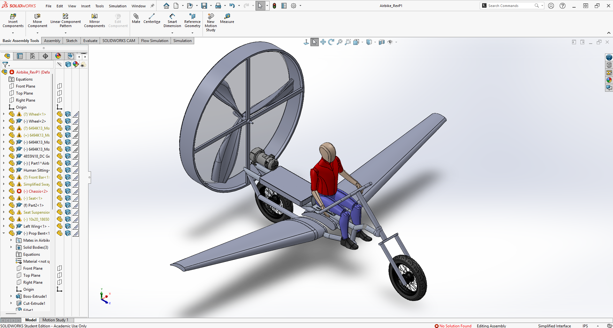
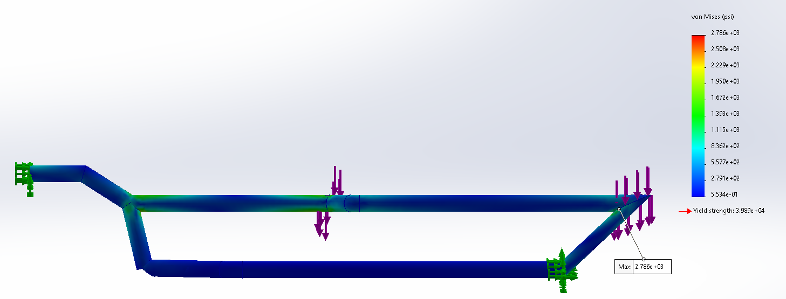
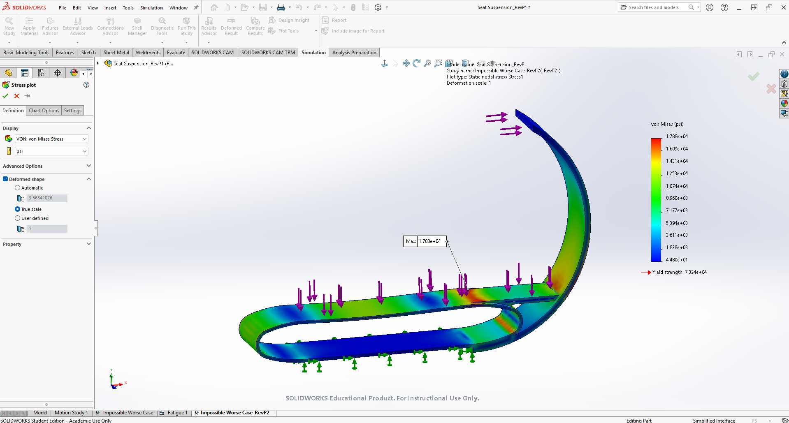
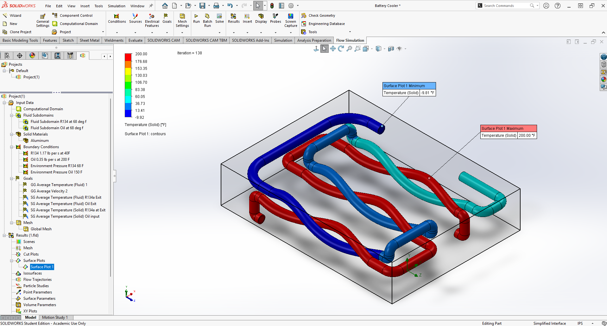

# Electric Airbike Simulations — Quick Overview

**Simulation-Driven Vehicle Engineering & Multiphysics Optimization**  
**Author / Engineer:** Lucas Lebron  
**Role:** Full-Vehicle CAD Integration, Structural FEA (Linear & Nonlinear), Rotating-Region CFD, and Thermal CHT Analysis  
**Read Time:** ~3 minutes

  <a href="airbike.html" class="bp-btn bp-btn-primary">
  Read Full Technical Deep-Dive Report →
  </a>
  <a href="airbike-cad-viewer.html" class="bp-btn bp-btn-secondary">
  Launch Interactive 3D Viewer ⛶
  </a>
  <a href="../" class="bp-btn bp-btn-secondary">
  ← Back to Home
  </a>

---

## Executive Summary

Given fixed baseline coordinates for the front/rear wheels, steering handlebars, and rear drive motor, I designed a single-operator **electric personal airbike** in SolidWorks. 

Rather than treating simulation as a post-design validation step, computational analysis was actively utilized to drive geometric and material revisions across the vehicle. Through finite element analysis (FEA), computational fluid dynamics (CFD), and conjugate heat transfer (CHT), structural weaknesses, aerodynamic deficiencies, and thermal runaway risks were exposed and resolved.

*Final Electric Airbike assembly modeled in SolidWorks, showcasing the tubular chassis, operator packaging, mid-mounted battery/cooling core, swept wings, and rear ducted fan.*

---

## Key Parameters at a Glance

| Subsystem | Specification / Parameter | Performance / Result |
|:---|:---|:---|
| **Chassis Material** | 6061-T6 Aluminum Round Tube | 2.50" OD × 0.25" Wall (primary) / 2.0" OD (bracing) |
| **Chassis Peak Stress** | 52,330 psi (V1 unsupported) → **2,786 psi** (V2 braced) | **-94.7% stress reduction** (Yield: 39,890 psi) |
| **Chassis Deflection** | 5.512 in (V1 unsupported) → **0.034 in** (V2 braced) | **-99.4% deflection reduction** |
| **Chassis Factor of Safety**| 0.76 (Immediate failure) → **14.32** (High margin) | **+1,784% structural safety margin** |
| **Operator Seat & Leaf Spring** | 7075-T6 High-Strength Aluminum Sheet | Peak stress 17,880 psi; Minimum FOS = 4.10 |
| **Lifting Wing Structure** | Custom tapered airfoil | Balsa core failed (FOS 0.605) → Upgraded to 6061-T6 |
| **Ducted Propeller Propulsion** | Shrouded multi-blade rotating region | **798.5 lbf** converged average forward thrust |
| **Battery Array** | 10×20 Cylindrical 18650 cell pack | Passive cooling failed ($770,100^\circ\text{F}$ runaway artifact) |
| **Liquid Heat Exchanger** | Serpentine CHT (R-134a / Dielectric Oil) | $\dot{m}_{\text{R134a}} = 1.17\text{ lb/s}$, $\dot{m}_{\text{oil}} = 0.35\text{ lb/s}$; $50\text{ psia}$ loop |

---

## Core Engineering Challenges & Solutions

### 1. Chassis Bending Failure → Truss Triangulation
- **Problem:** In the initial cantilevered frame (Version 1), static loading under a 200 lbf rider and 400 lbf fan caused 5.51 inches of elastic deflection and 52,330 psi peak stress, failing yield with an FOS of 0.76.
- **Solution:** Integrated dual angled vertical rear truss tubes (2.0" OD × 0.25" wall), triangulating the propulsion load path into the rear wheel mount. Max stress plummeted to 2,786 psi (-94.7%), deflection dropped to 0.034 inches (-99.4%), and minimum FOS increased to 14.32.

*Chassis V2 FEA showing order-of-magnitude stress reduction well below 6061-T6 yield strength.*

### 2. Seat Ergonomics & Nonlinear Dynamic Loading
- **Challenge:** Rider weight dynamically shifts rearward during vehicle acceleration, inducing cyclic fatigue.
- **Action:** Formulated a 100-step nonlinear simulation over a 2.0-second time interval transferring 25% of load to the backrest. To mitigate compliance, engineered an integrated 7075-T6 continuous-arc leaf spring suspension bracket (RevP2), reducing peak stress by 40.7% and raising FOS to 4.10.

*Seat Suspension RevP2 static nodal stress contour (17.88 ksi max stress; 4.10 factor of safety).*

### 3. Battery Passive Runaway → Active CHT Heat Exchanger
- **Problem:** Convective thermal modeling of the 200-cell battery pack produced a simulated temperature of $770,100^\circ\text{F}$. Recognizing that cells undergo catastrophic thermal runaway around $300^\circ\text{F}$, this exposed passive cooling as fundamentally impossible.
- **Solution:** Replaced passive fins with an active dual-fluid conjugate heat transfer (CHT) serpentine heat exchanger. Derived mass flow boundary conditions ($\dot{m}_{\text{R134a}} = 1.17\text{ lb/s}$, $\dot{m}_{\text{oil}} = 0.35\text{ lb/s}$) to ensure numerical continuity across thermal gradients.

*Conjugate heat transfer simulation displaying fluid temperature gradients through the serpentine cooling core.*

### 4. Vehicle-Level Thrust-to-Weight Synthesis
- **Action:** Executed a rotating-region CFD study on the ducted fan, verifying 798.5 lbf thrust. Comparing this against the 3,000 lbm vehicle mass revealed a marginal $T/W \approx 0.27$, driven by early solid-modeled aluminum wings.
- **Optimization:** Defined a design roadmap transitioning wings to ribbed/sparred hollow composite construction to cut wing mass by $>60\%$, thinning chassis tube walls in low-stress zones (leveraging the 14.3 FOS), and enlarging fan duct diameter.

---

## Technical Documentation & Downloads

- **[Full Technical Deep-Dive Report](airbike.html)**  
  *Complete, comprehensive technical case study covering all equations, FEA plots, CFD vector contours, and engineering derivations.*
- **[Electric Airbike CAD Model Assembly (Interactive 3D Viewer)](airbike-cad-viewer.html)** • [Direct 3D Model (.GLB)](../assets/models/airbike/airbike-assembly.glb)
- **[Electric Airbike Full Technical Presentation (PPTX)](../assets/docs/airbike/electric-airbike-final-presentation.pptx)**  
  *136-slide original presentation containing all setup screens, boundary conditions, and full result plots.*

---

[← Back to Portfolio Home](../)
