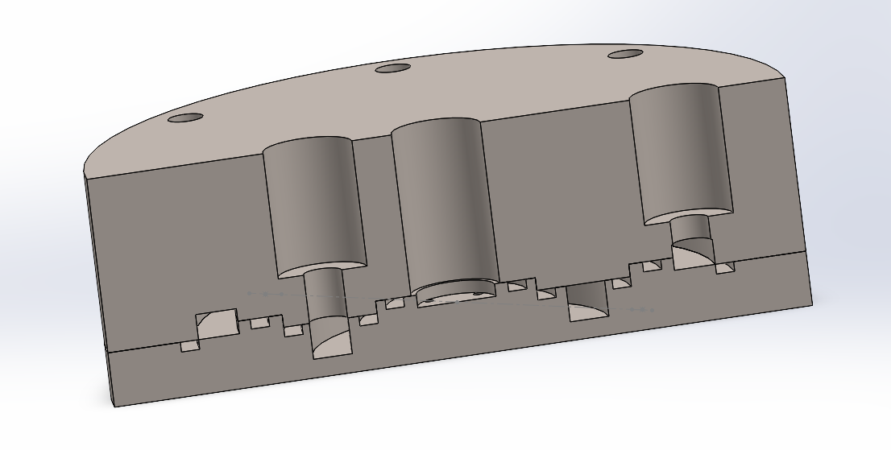
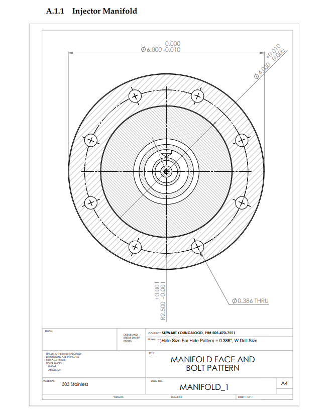
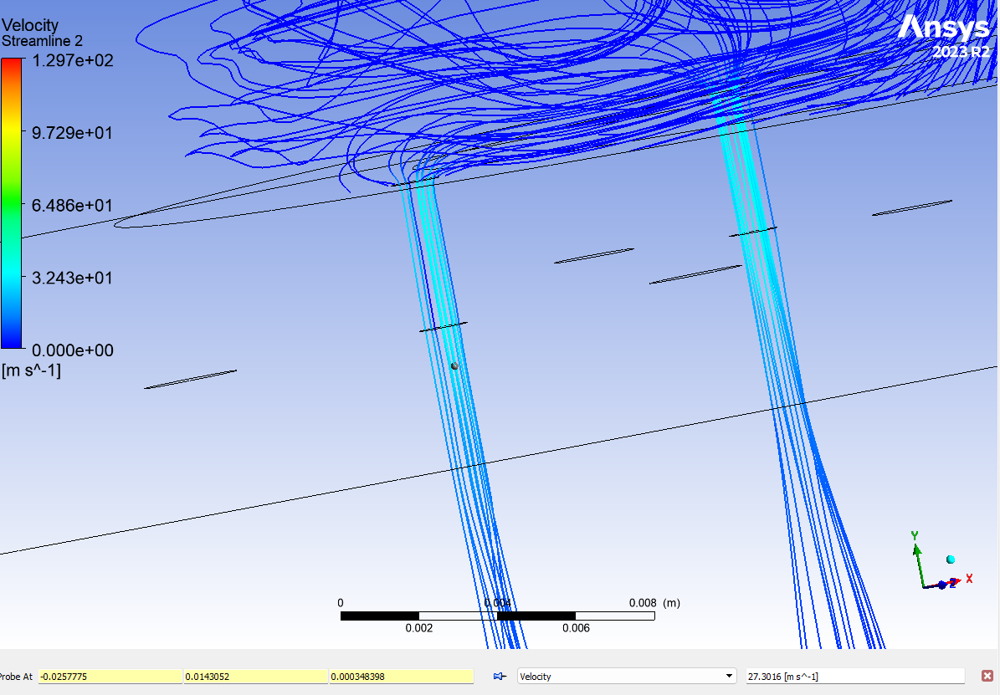

# Impinging Injector for 250 lbf Rocket Engine — Quick Overview

**Kennesaw State University Liquid Propulsion Team — STRIX 250 lbf Engine**  
**Role:** Injector CAD Lead, Injector Sizing, Mechanical Interface Design, and CFD Validation  
**Read Time:** ~3 minutes

  <a href="injector/" class="bp-btn bp-btn-primary">
  Read Full Technical Deep-Dive (15-min read) →
  </a>
  <a href="injector-cad-viewer.html" class="bp-btn bp-btn-secondary">
  Launch Interactive 3D Viewer ⛶
  </a>
  <a href="../" class="bp-btn bp-btn-secondary">
  ← Back to Home
  </a>

---

## Executive Summary

The Kennesaw State University Liquid Propulsion Team is developing **STRIX**, a 250 lbf bi-propellant liquid rocket engine utilizing nitrous oxide (N₂O) and ethanol. The injector meters propellants from the feed system into the combustion chamber while ensuring atomization and mixing.

My primary responsibility was the **iterative CAD design of the injector top plate**, sizing and positioning the **bulkhead bolt pattern for both plates**, conducting preliminary orifice sizing, and **validating impingement geometry using ANSYS CFD**.

*Final two-plate impinging injector assembly showing propellant inlet channels and internal flow geometry.*

---

## Key Parameters at a Glance

| Parameter | Specification | Engineering Rationale |
|:---|:---|:---|
| **Target Thrust** | 250 lbf (1,112 N) | University propulsion demonstration target |
| **Propellants** | Nitrous Oxide (N₂O) / Ethanol | Self-pressurizing oxidizer with high-density alcohol fuel |
| **O/F Mixture Ratio** | 4.25 | Thermochemically optimized for combustion efficiency |
| **Total Mass Flow Rate** | 0.567 kg/s | Calculated from thrust and target specific impulse ($I_{sp} = 200\text{ s}$) |
| **Manifold Pressure** | 900 psi | Feed-system delivery pressure |
| **Chamber Pressure** | 780 psi | Engine operating chamber pressure |
| **Injector Pressure Drop** | 120 psi (~15.4% $P_c$) | Sized to suppress feed-system chugging and combustion instability |
| **Oxidizer Orifice Size** | 1.84 mm ($V = 27.55\text{ m/s}$) | Orifice flow sizing using liquid N₂O density ($785.06\text{ kg/m}^3$) |
| **Fuel Orifice Size** | 1.26 mm ($V = 27.37\text{ m/s}$) | Orifice flow sizing using Ethanol density ($789.4\text{ kg/m}^3$) |
| **Impingement Half-Angle**| 45° ($L_{imp} = 7.74\text{ mm}$) | Optimized for atomization and spray distribution |

---

## Core Engineering Challenges & Solutions

### 1. The Design Pivot: Coaxial Swirl → Impinging Architecture
- **Problem:** The team's original concept was a coaxial swirl injector. As the design matured toward fabrication, the geometric complexity and micro-tolerances required for internal swirl chambers were determined to be impractical for university CNC resources.
- **Solution:** Transitioned to an impinging injector utilizing a precision two-plate architecture (Top Plate manifold and Bottom Plate orifice plate). This simplified CNC machining while meeting all fluid-dynamic and atomization targets.

### 2. Top-Plate CAD & Packaging
- **Challenge:** Packaging high-pressure fluid manifolds (900 psi), O-ring sealing grooves, and external propellant connections within tight radial geometric envelopes.
- **Action:** Iteratively developed the top plate CAD in SolidWorks, routing internal passages to minimize head loss while ensuring sufficient wall thickness for burst pressure safety margins.

### 3. Bulkhead Bolt Pattern & Structural Safety
- **Challenge:** Clamping the two injector plates securely against 900 psi internal fluid pressure during hot-fire and cold-flow testing.
- **Action:** Sized and positioned an 8-bolt circular pattern positioned radially around the internal fluid passages to maintain uniform gasket clamping and provide a high factor of safety.

*Engineering drawing showing manifold face layout and 8-bolt bulkhead interface.*

### 4. CFD Verification of Impingement Convergence
- **Action:** Ran ANSYS CFD multi-phase velocity streamline simulations on the calculated orifice angles to verify that the oxidizer and fuel streams converge cleanly at the intended impingement region.
- **Validation:** CFD flow simulation yielded an injection velocity of **27.3 m/s**, providing computational support for the analytical hand calculations (~27.4–27.6 m/s).

*ANSYS velocity streamlines confirming stream convergence at the impingement point with probe value at 27.3 m/s.*

---

## Project Outcomes & Deliverables

- **Requirements-to-Hardware Progression:** Successfully progressed from high-level propulsion requirements through analytical sizing, 3D CAD modeling, and CFD validation to final manufacturing drawings.
- **Complete Technical Package:** Delivered production-ready drawings for the top plate and bottom plate, along with the Preliminary Design Review (PDR).
- **Interactive 3D Deliverable:** Exported the complete assembly into a lightweight interactive 3D model for remote design reviews.

---

## Technical Documentation & Downloads

For detailed derivations, equations, and full drawings, refer to the technical documents below:

- **[Full Technical Deep-Dive Report (15-min read)](injector/)**
- **[Interactive 3D CAD Viewer (Browser-based)](injector-cad-viewer.html)**
- **[Preliminary Design Review (PDR) (PDF)](../assets/docs/injector/liquid-propulsion-preliminary-design-review.pdf)**
- **[Impinging Injector Manufacturing Drawings (PDF)](../assets/docs/injector/impinging-injector-drawings.pdf)**
- **[Original Coaxial Swirl Injector Drawings & Manufacturing Plan (PDF)](../assets/docs/injector/coaxial-swirl-manufacturing-plan.pdf)**
- **[Injector Sizing Tool (MATLAB .m)](../assets/docs/injector/coaxial-swirl-injector-sizing.m)**

---

[← Back to Portfolio Home](../)
