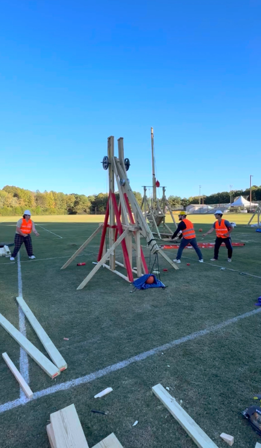

# Floating Arm Trebuchet — Quick Overview

**Engineering Dynamics Competition | Team Captain**  
**Component:** Full-Scale Floating Arm Trebuchet for 10 lb Payload  
**Role:** Team Captain, Structural Layout, Fastener Planning, Fabrication & Testing  
**Read Time:** ~2 minutes

  <a href="trebuchet.html" class="bp-btn bp-btn-primary">
  Read Full Project Report (6-min read) →
  </a>
  <a href="../" class="bp-btn bp-btn-secondary">
  ← Back to Home
  </a>

---

## Executive Summary

Served as Team Captain leading 10 engineering students through the design, drafting, procurement, fabrication, and testing of a **Floating-Arm Trebuchet (FAT)**. The system was engineered to launch a **10 lb pumpkin** for maximum horizontal distance under a strict **$500 budget constraint** and a compressed **1-month timeline**.

*Full-scale floating-arm trebuchet fielded during the university engineering dynamics competition, showing the vertical guide tracks, drop-channel axle, and team loading the 10 lb pumpkin payload into the sling pouch.*

---

## Project Parameters & Constraints

| Parameter | Specification |
|---|---|
| **Event** | School-Wide Engineering Dynamics Trebuchet Competition |
| **Objective** | Maximum horizontal range with 10 lb pumpkin |
| **Team Size** | 10 Engineering Students |
| **Budget Constraint** | \$500 max ($462.14 allocated in BOM; $37.86 reserve) |
| **Development Time** | ~1 Month (concurrent design, procurement, and build) |
| **Architecture** | Floating-Arm Trebuchet (Linear Drop Channel) |
| **Structural Frame** | 90" vertical mast, 45.5" base spread, 30° diagonal bracing |
| **Materials** | Dimensional lumber (2×4 Whitewood, 2×4 & 2×8 Southern Yellow Pine) |
| **Hardware** | 8" cast iron wheels, 1/2" steel axle, 3/8" & 1/2" grade bolts, #14 screws |
| **Competition Result** | **9th of 14 Teams** |

---

## Core Engineering Highlights

### 1. Structural Layout & Fastener Planning
- Developed a complete half-frame working drawing package with 90-inch drop height and 45.5-inch base spread.
- Pre-calculated fastener locations, dual bolt-length specifications (3/8"-16 × 8" through-bolts and 1/2"-13 × 4" shear bolts), and lumber cut-lists to minimize waste.

### 2. Rigorous Budget Allocation
- Formulated a pre-procurement Bill of Materials across 13 line items totaling \$462.14, maintaining a $37.86 contingency reserve under the non-negotiable $500 cap.

### 3. Hands-On Wood & Metal Fabrication
- Concurrently fabricated frame subassemblies on the staging grounds, aligning twin vertical guide tracks, drilling perpendicular laminated bores, and burnishing paste finishing wax to reduce rolling friction.

### 4. Objective Performance & Key Takeaways
- Successfully launched the 10 lb payload in competition, placing 9th out of 14 teams.
- Diagnosed real-world dynamic friction and release timing sensitivity in the coupled floating arm, deriving foundational engineering lessons on mechanism complexity vs. schedule margins.

---

## Technical Documentation & Downloads

- **[Full Technical Deep-Dive Report](trebuchet.html)** — Complete analysis, frame drawings, annotated calculations, and lessons learned.
- **[Initial Frame Drafting Package (PDF)](../assets/docs/trebuchet/trebuchet-initial-draft.pdf)**
- **[Bill of Materials (BOM) Spreadsheet (XLSX)](../assets/docs/trebuchet/trebuchet-temp-bom.xlsx)**

---

[← Back to Portfolio Home](../)
